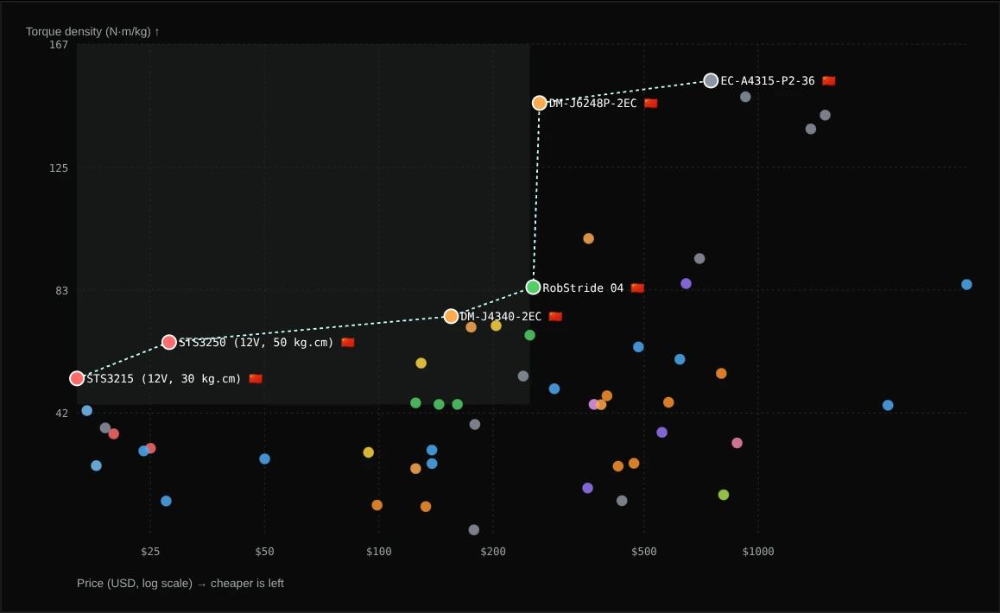
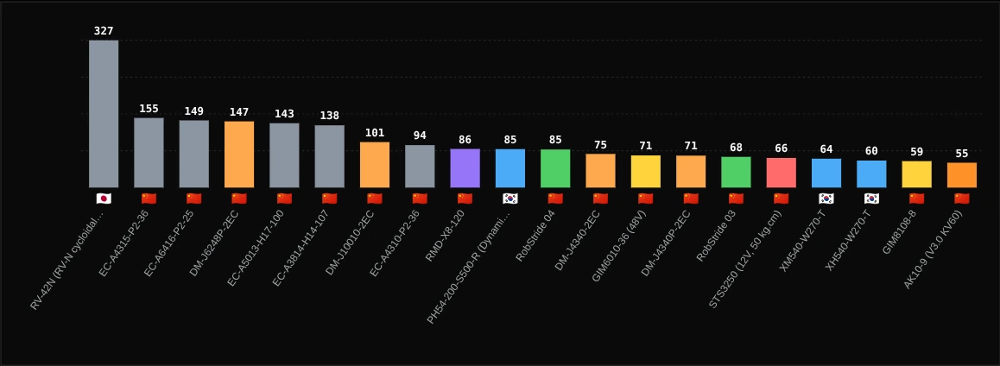
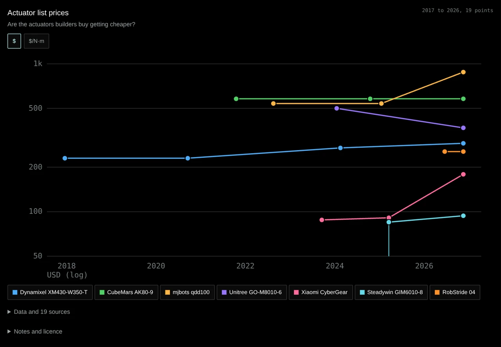
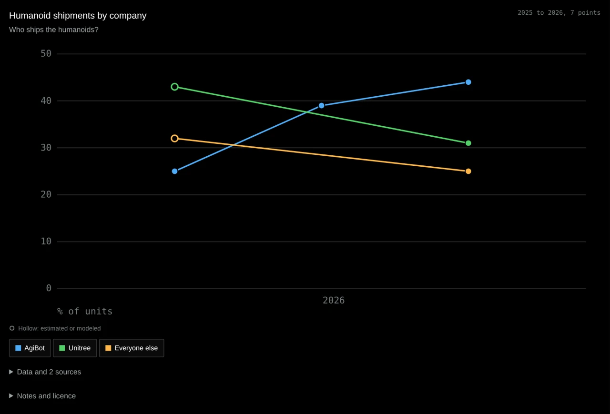
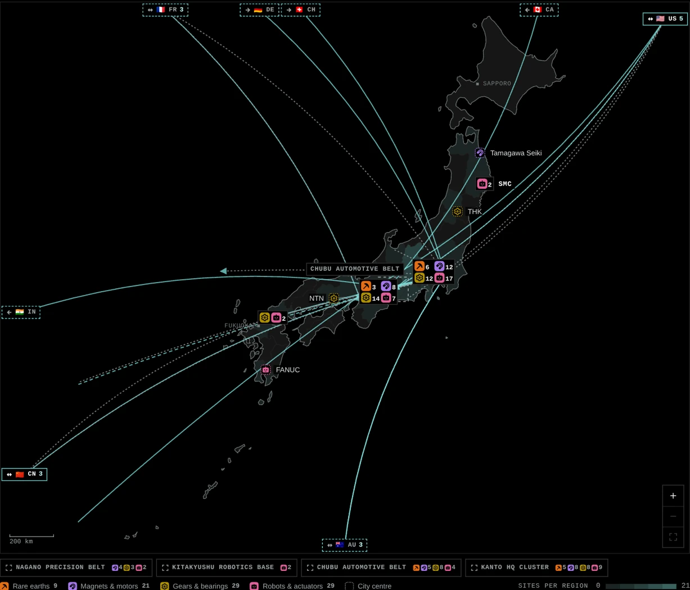
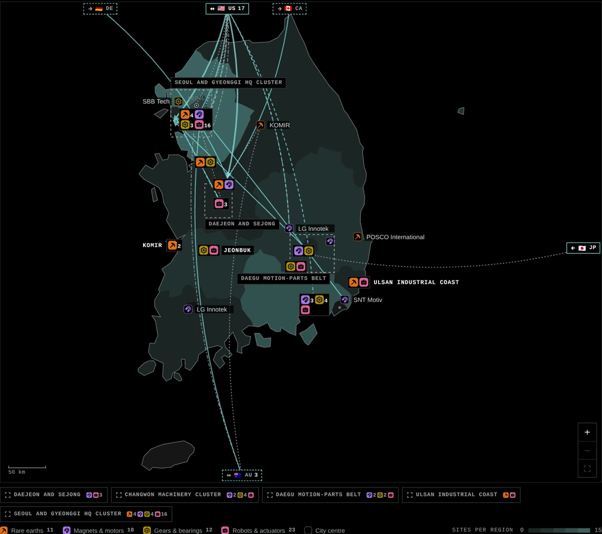
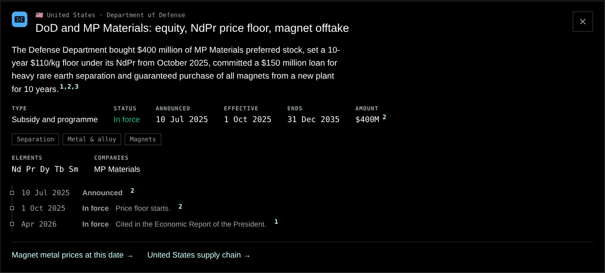
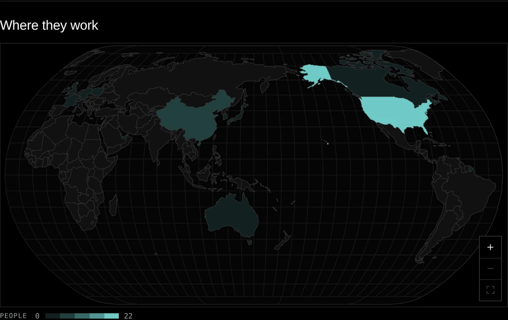

# actuatorlist

Independent analysis of robot actuators and their supply chains.

**[Catalog](https://actuatorlist.com/actuators)** · **[Compare](https://actuatorlist.com/compare)** · **[Trends](https://actuatorlist.com/trends)** · **[API](https://actuatorlist.com/docs/api)** · **[MCP](https://actuatorlist.com/agents.md)**

### [Torque density vs. cost](https://actuatorlist.com/#scatter)

[](https://actuatorlist.com/#scatter)

### [Torque-density ranking](https://actuatorlist.com/#rankings) · peak N·m/kg

[](https://actuatorlist.com/#rankings)

### [Actuator prices over time](https://actuatorlist.com/trends?chart=actuator-prices)

[](https://actuatorlist.com/trends?chart=actuator-prices)

<details>
<summary>More from Trends</summary>

**[Humanoid shipments by company](https://actuatorlist.com/trends?chart=humanoid-share)**

[](https://actuatorlist.com/trends?chart=humanoid-share)

</details>

## Actuator supply chains by country

[🇯🇵 Japan](https://actuatorlist.com/japan) · [🇨🇳 China](https://actuatorlist.com/china) · [🇰🇷 South Korea](https://actuatorlist.com/korea) · [🇺🇸 United States](https://actuatorlist.com/us)

| [🇯🇵 Japan](https://actuatorlist.com/japan) | [🇰🇷 South Korea](https://actuatorlist.com/korea) |
| :---: | :---: |
| [](https://actuatorlist.com/japan) | [](https://actuatorlist.com/korea) |

### [Policy tracker · 🇺🇸 United States](https://actuatorlist.com/policy#measure=us-dod-mp-partnership-2025)

[](https://actuatorlist.com/policy#measure=us-dod-mp-partnership-2025)

### [Where actuator researchers and industry leaders work](https://actuatorlist.com/people#pp-map-h)

[](https://actuatorlist.com/people#pp-map-h)

## For agents

| Connect | Read |
| --- | --- |
| [MCP server card](https://actuatorlist.com/.well-known/mcp/server-card.json) · [REST API](https://actuatorlist.com/api) · [OpenAPI](https://actuatorlist.com/openapi.json) | [Agent skill](skills/actuatorlist/SKILL.md) · [llms.txt](https://actuatorlist.com/llms.txt) · [Full catalog text](https://actuatorlist.com/llms-full.txt) |

MCP uses Streamable HTTP. The API and MCP are public and read-only.

```bash
claude mcp add --transport http actuatorlist https://actuatorlist.com/mcp
```

## Contribute

- [Report a data error or suggest a part](https://github.com/Miyamura80/actuatorlist/issues/new). Include a manufacturer page or datasheet.
- [Edit actuator data](frontend/src/data/actuators.json) or [robot data](frontend/src/data/robots.json). Follow the [schema](docs/catalog-schema.md) and use `null` for unknown values.
- [Submit a bench test or contribute code](CONTRIBUTING.md) · [Report a security issue privately](SECURITY.md)

<details>
<summary>Run locally with Bun</summary>

```bash
make setup
uv tool install prek && prek install
(cd frontend && bun install && bun run build)
bun run scripts/serve_frontend.ts  # http://localhost:3000
```

Use `cd frontend && bun run dev` for Vite. Run `make validate_data` for catalog edits and `make ci` before opening a PR. See [logo setup](docs/brand-logos.md) and the [image sync workflow](.github/workflows/fetch-actuator-images.yaml).

</details>

[MIT code](LICENSE) · [CC BY 4.0 data](LICENSE-DATA). Credit “actuatorlist.com (Eito Miyamura)” when reusing the data. Robot joint data credited to Reece O'Mahoney of [UnitZero](https://unitzero.ai).
